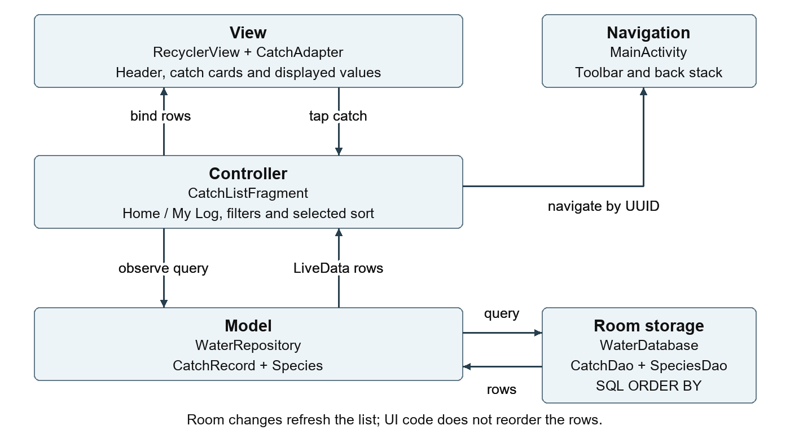
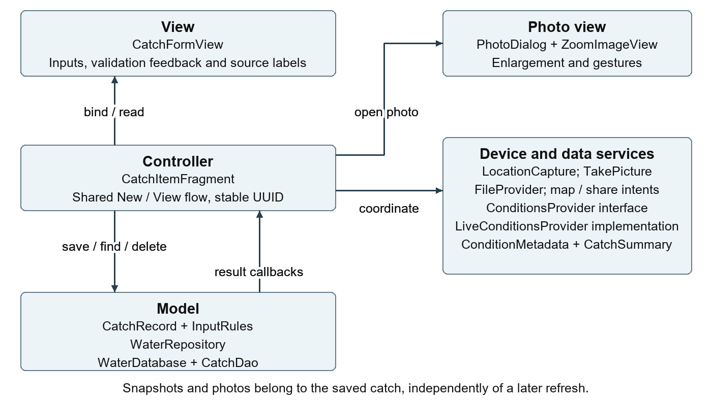
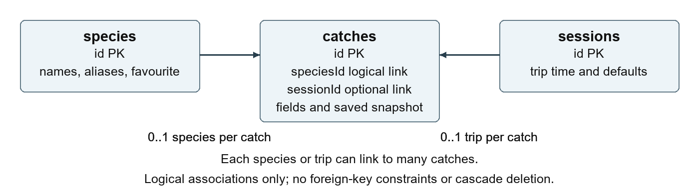

# Report design and implementation notes

The completed template is in [submission/WaterLogged_CSC202_Task3_Report.docx]
## MVC for List UI

CatchListFragment controls day, filters and ordering, observes repository results and passes rows to CatchAdapter. RecyclerView and bound cards form the View. CatchRecord, Species and WaterRepository form the Model; WaterDatabase exposes Room DAOs. MainActivity handles navigation and toolbar actions. A selected catch passes its UUID to Item UI. New opens species selection, then the same Item fragment in new-entry mode.

WaterRepository serialises background writes and returns main-thread callbacks. CatchDao uses ORDER BY caughtAt DESC and ORDER BY lengthCm IS NULL ASC, lengthCm ASC, with deterministic tie-breakers; unknown lengths come last. Filtering also stays in SQL. Room LiveData refreshes the list after writes. SharedPreferences retains the chosen sort.

## MVC for Item UI

CatchItemFragment shares New/View behaviour, distinguishing species arguments from an existing UUID. CatchFormView owns widgets, presentation and typed extraction; InputRules checks numeric conversion/bounds. Optional length/weight may be empty; title, location and quantity are required. Invalid input preserves the last valid row. DatePickerDialog and TimePickerDialog edit timestamps. Delete appears only when reopening.

Stable UUIDs prevent duplicate saves. Valid changes save after 900 ms, on exit and backgrounding. Copies isolate queued writes; draft state survives recreation. Delete cancels pending saves before removing the row/photo. LocationCapture handles foreground permissions, fresh fixes and timeout; Show map uses the saved mark. TakePicture and FileProvider store private photos; PhotoDialog/ZoomImageView enlarge, pinch, pan and reset. CatchSummary previews the sharesheet payload.

ConditionsProvider separates retrieval from control. Nearby observations precede labelled models; ConditionMetadata preserves source, applicable/retrieval times and manual ownership. Reopening keeps saved snapshots. Weather/geocoder requests use rounded coordinates. Shares exclude exact marks, photos and notes, although place names can reveal a spot. The design is MVC-style: fragments also create views and manage Android lifecycle.

## Database design

WaterDatabase version 4 stores catches, species and sessions in water_logged.db, using TEXT primary keys. Catch speciesId/sessionId are logical links without foreign keys/cascades; stored titles remain independently readable. CaughtAt/lengthCm are indexed. Unique nullable sessions.activeSlot allows one active trip and multiple ended trips. Tested migrations 1→2→3→4 preserve records without destructive fallback.

There are no SQL DEFAULT clauses. New catches initialise UUID/current time, Inshore, quantity 1, Released, empty text, Unknown trend, Not recorded moon and Manual / not recorded source; optional fields are null. New sessions initialise UUID/current time, activeSlot 1, Inshore and empty text. Species come from the catalogue/custom entry; favourite uses INTEGER 0/1.

Private photos use photoPath references rather than blobs. Automatic Android backup/transfer is disabled. Encrypted .wlog exports include catches, photos, favourites, sessions and snapshots; restore validates and merges missing UUIDs. CSV is unencrypted, excluding coordinates by default. Clearing storage/uninstalling removes the diary without an external backup. Physical-device checks, wider coverage, catch-limit and marine-park alerts remain future work.

### catches

| Column | SQLite type | Usage |
|---|---|---|
| id | TEXT NN PK | Stable catch UUID |
| speciesId | TEXT NN | Catalogue or custom species association |
| title / locationName | TEXT NN | Editable species title and general place |
| caughtAt | INTEGER NN | Catch time in epoch milliseconds |
| environment / disposition | TEXT NN | Water type and kept/released/bait/other |
| lengthCm / weightKg | REAL | Optional measured length and weight |
| quantity | INTEGER NN | Number of fish in this entry |
| bait / method / notes | TEXT NN | Fishing details and multiline notes |
| latitude / longitude | REAL | Exact private catch mark |
| accuracyMetres | REAL | Device location accuracy |
| locationCapturedAt | INTEGER | Location fix epoch milliseconds |
| photoPath | TEXT | Private camera file path |
| tideHeightM | REAL | Predicted/manual height above LAT |
| tideDirection | TEXT NN | Water-level trend, not current speed |
| windKmh / windGustKmh | REAL | Sustained wind and separate gust |
| windDirection | TEXT NN | Compass wind direction |
| airTemperatureC | REAL | Air temperature |
| swellM / waveHeightM | REAL | Swell component and total significant waves |
| moonPhase | TEXT NN | Calculated or manually selected phase |
| conditionsSource | TEXT NN | Snapshot source summary |
| conditionsMetadata | TEXT | Per-field provenance/ownership JSON |
| tideStationId | TEXT | Gauge override; null selects nearest |
| sessionId | TEXT | Optional trip association |
| tideSeriesJson | TEXT | Saved daily tide samples and provenance |

### species

| Column | SQLite type | Usage |
|---|---|---|
| id | TEXT NN PK | Stable catalogue key or custom UUID key |
| commonName / scientificName / aliases | TEXT NN | Display and case-insensitive partial search |
| favourite | INTEGER NN | User preference as 0/1 |

### sessions

| Column | SQLite type | Usage |
|---|---|---|
| id | TEXT NN PK | Trip UUID |
| startedAt | INTEGER NN | Trip start epoch milliseconds |
| endedAt | INTEGER | Trip end; null while active |
| activeSlot | INTEGER UNIQUE | 1 while active; null after ending |
| locationName / bait / method / environment | TEXT NN | Defaults copied to each new catch |
| latitude / longitude | REAL | Optional default trip point |

NN = NOT NULL, PK = primary key; all other fields are nullable. Schema columns have no SQL DEFAULT clauses. New-object Java values are described above. Reference images are bundled assets linked by stable species IDs, rather than image blobs/resource integers in Room.
